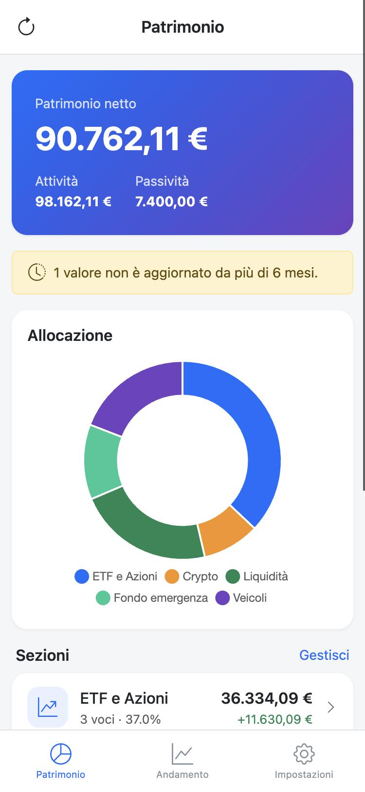
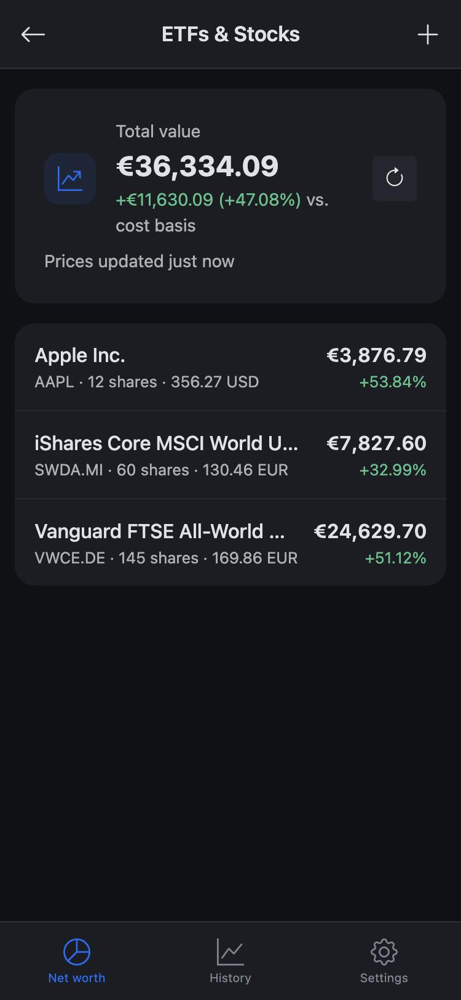
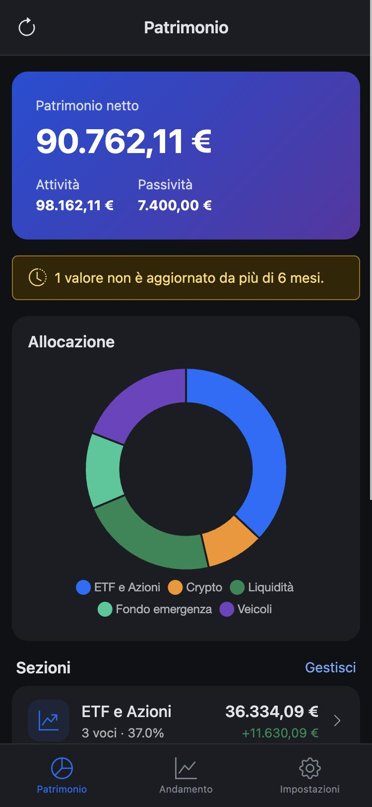

<div align="center">


# Tracktage

**Your net worth, all in one place.**
ETFs, stocks, crypto, bank accounts, emergency fund, cars, real estate and debts in a single web app, with prices updated automatically.


</div>

<p align="center">
  
  
  
  
</p>

---

## Why

Net worth spreadsheets get out of hand: prices to update by hand, formulas that break, no history.
Tracktage is a **self-hosted, personal** web app that installs on your phone like a native app.
ETF prices update on their own, and every day it saves a snapshot of your net worth, so you can
actually see how it grows over time.

No third-party cloud, no subscriptions, no data sharing: just PHP and a SQLite file, on your own server.

## Features

- 📈 **Live prices** for ETFs, stocks and crypto from Yahoo Finance, with no API key, caching and automatic conversion to your base currency
- 🔎 **Instrument search** by ticker, name or ISIN (`IE00BK5BQT80` → `VWCE.DE`)
- 💰 **Gain/loss** against your average cost, per holding and per section
- 🗂️ **Custom sections**, each either *market-priced* (ticker × shares) or *manual* (cars, accounts, property…), with their own icon and color
- ➖ **Liabilities**: mortgages and loans are subtracted from your net worth
- 📊 **History** of your net worth and of each section (1M, 3M, 1Y, 5Y, all time)
- ⏰ **Reminders** for manual values that haven't been updated in a while (6 months by default)
- 🌙 **Light, dark or automatic theme**
- 🌍 **English and Italian**, switchable per device from Settings, with numbers and dates in the right format
- 💾 **One-tap backups**: CSV of your holdings, CSV of your history (Excel-ready) or the full database
- 📱 **Mobile-first PWA**, installable on the iOS and Android home screen
- 🔒 **Single-user access**, with no public sign-up (see [Security](#-security))

## Stack

| | |
|---|---|
| **Backend** | Vanilla PHP 8.1+, no framework, no Composer |
| **Database** | SQLite (WAL), created and migrated automatically on first run |
| **Frontend** | jQuery 3.7, Bootstrap 5.3, Bootstrap Icons, Chart.js 4 |
| **Prices** | Yahoo Finance (chart + search API), cached in the database |

Frontend libraries are bundled in `vendors/`. Chart.js is loaded from jsDelivr with a pinned version.

## Quick start

**Requirements:** PHP 8.1+ with the `pdo_sqlite` and `curl` extensions.

```bash
git clone https://github.com/<your-username>/tracktage.git
cd tracktage
cp .env.example .env
```

For local development, set these in `.env`:

```env
BASE_URL=http://localhost:8000/
DEFAULT_LANG=en
SESSION_SECURE=false
APP_DEBUG=true
```

Create your user (you'll be prompted for the password, which is hidden as you type):

```bash
php bin/create-user.php you@example.com "First" "Last"
```

Start the server:

```bash
php -S localhost:8000 index.php
```

Open <http://localhost:8000>: on first login the default sections are already there, ready to fill in.

> The same `create-user.php` command also **resets the password** of an existing user.

## Configuration

Everything is configured in the `.env` file:

| Variable | Default | Description |
|---|---|---|
| `BASE_URL` | `http://localhost:8000/` | Public URL of the app, **with the trailing slash** |
| `DEFAULT_LANG` | `it` | Default language (`it` or `en`), also used for the default section names on first run |
| `SESSION_NAME` | `tracktage_session` | Session cookie name |
| `DB_PATH` | `database/tracktage.sqlite` | Database path, relative to the project root or absolute |
| `BASE_CURRENCY` | `EUR` | Currency your whole net worth is expressed in |
| `PRICE_CACHE_MINUTES` | `15` | How long price quotes are cached |
| `STALE_MONTHS` | `6` | Months after which a manual value is flagged as outdated |
| `SESSION_SECURE` | `true` | Send the cookie over HTTPS only. Set to `false` only locally |
| `APP_DEBUG` | `false` | Show error details. Never `true` in production |

Environment variables that are already set take precedence over `.env`, which is handy for tests or containers:

```bash
DB_PATH=/tmp/demo.sqlite php -S localhost:8001 index.php
```

## Supported tickers

Tickers use the Yahoo Finance format, with the exchange suffix. In the form you can also search by name or ISIN.

| Market | Example |
|---|---|
| Borsa Italiana (Milan) | `SWDA.MI`, `CSSPX.MI` |
| Xetra | `VWCE.DE`, `EUNL.DE` |
| Euronext Amsterdam | `IWDA.AS` |
| London Stock Exchange | `VWRA.L` (prices quoted in pence are converted) |
| US | `AAPL`, `MSFT`, `VOO` |
| Crypto | `BTC-EUR`, `ETH-EUR` |

Prices in currencies other than `BASE_CURRENCY` are converted at the current exchange rate.

## Production deployment

1. Upload the project to your server, **without** your local `.env` and `database/` (both are already in `.gitignore`).
2. Create the `.env` with `SESSION_SECURE=true`, `APP_DEBUG=false` and your HTTPS `BASE_URL`.
3. Make the `database/` folder writable by the web server (the folder, not just the file: SQLite creates its WAL files there), and `api/` too, where the log folder is created.
4. Create your user with `php bin/create-user.php`.
5. **Check** that `https://yourdomain/.env` and `https://yourdomain/database/tracktage.sqlite` return **403**.

> 💡 Even better: move the database **outside the document root** with `DB_PATH=/home/user/data/tracktage.sqlite`.

### Apache

Works out of the box with the bundled `.htaccess`: `mod_rewrite` and `AllowOverride All` are required.

### Nginx

Nginx ignores `.htaccess` files, so the rules go in the server configuration:

```nginx
server {
    root /var/www/tracktage;
    index index.php;

    # Folders and files that must never be served
    location ~ ^/(database|bin|config|middleware|components|views|api/(utils|services|log))/ { deny all; }
    location ~ /\.(?!well-known) { deny all; }
    location ~ \.(sqlite|sqlite3|sql|md)$ { deny all; }

    location / {
        try_files $uri $uri/ /index.php?$query_string;
    }

    location ~ \.php$ {
        include fastcgi_params;
        fastcgi_param SCRIPT_FILENAME $document_root$fastcgi_script_name;
        fastcgi_pass unix:/run/php/php8.3-fpm.sock;
    }
}
```

### Moving your data from local to the server

The SQLite file holds everything. Create a consistent copy and upload it as `database/tracktage.sqlite`:

```bash
sqlite3 database/tracktage.sqlite ".backup database/upload.sqlite"
```

Alternatively, download the database from **Settings → Backup**.

## 🔒 Security

Tracktage is built for **a single user** and holds sensitive data, so:

- **No web sign-up**: users can only be created from the command line on the server
- Passwords hashed with **bcrypt**, automatically rehashed if the algorithm changes
- **Login rate limiting**: 5 failed attempts per IP within 15 minutes
- **CSRF tokens** on every request that changes data
- `HttpOnly`, `SameSite=Strict` session cookies, `Secure` over HTTPS, with the session ID regenerated on login
- `X-Frame-Options`, `X-Content-Type-Options` and `Referrer-Policy` headers
- Database, configuration, scripts and logs blocked at the web server level
- CSV exports protected against Excel *formula injection*

## Backup

From **Settings → Backup**:

| Export | Contents |
|---|---|
| **Holdings** (CSV) | One row per holding: section, ticker, shares, prices, value, gain, notes |
| **History** (CSV) | One row per saved day, with the total of each section |
| **Full database** (`.sqlite`) | A consistent copy of everything: to restore, put it back in `database/` |

CSV files follow the selected language: `;` and a decimal comma in Italian, `,` and a decimal point in English, so they open correctly in Excel.

## Project structure

```
├── api/
│   ├── endpoint/      # One file per action: auth, assets, categories, market, portfolio, backup
│   ├── services/      # PriceService (quotes and FX rates) · Portfolio (valuation and snapshots)
│   └── utils/         # SQLite connection, auth/CSRF, JSON responses, CSV, logger
├── assets/            # App icons and README screenshots
├── bin/               # create-user.php (CLI)
├── components/        # Head, top bar and bottom navigation
├── config/            # .env loader and configuration
├── database/          # schema.sql (+ the .sqlite file, ignored by git)
├── lang/              # Translations: it.php, en.php
├── script/            # Per-page JavaScript + app.js (shared helpers)
├── style/             # CSS with variables for light and dark themes
├── views/             # login · dashboard · category · statistics · settings
└── index.php          # Router (also used by the PHP development server)
```

**Request flow:** `index.php` → `views/*.php` → AJAX → `api/endpoint/*` → `api/services/*` → SQLite

## Notes

- Prices come from Yahoo Finance's **unofficial** public APIs, which may change or rate-limit requests. If a price is unavailable, the app falls back to the last cached one and flags it.
- History builds up as you use the app: one snapshot per day is saved when you open the dashboard.
- Tracktage is a personal tracking tool and **does not provide financial advice**.

## Roadmap

- [ ] Buy/sell transactions, with computed average cost and reconstructed history
- [ ] Daily snapshots via cron
- [ ] Goals: emergency fund target and ideal allocation with rebalancing suggestions
- [ ] Two-factor authentication (TOTP)
- [ ] Privacy mode to hide amounts
- [ ] Automatic vehicle depreciation

## Adding a language

1. Copy `lang/en.php` to `lang/xx.php` and translate the values (keys stay the same; missing keys fall back to Italian).
2. Add it to the `LANGS` map in `config/i18n.php` with its locale, e.g. `'de' => 'de-DE'`.

It will appear automatically in **Settings → Language** and on the login page.

## License

Released under the [MIT License](LICENSE).
