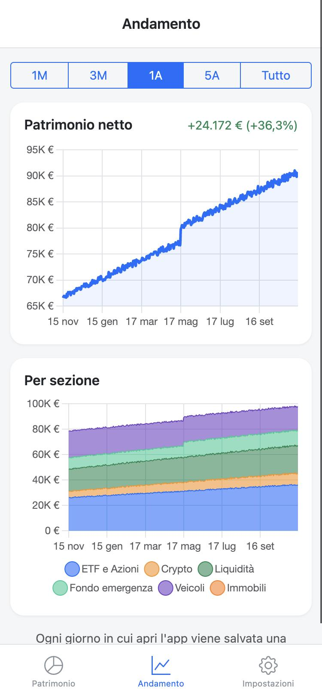
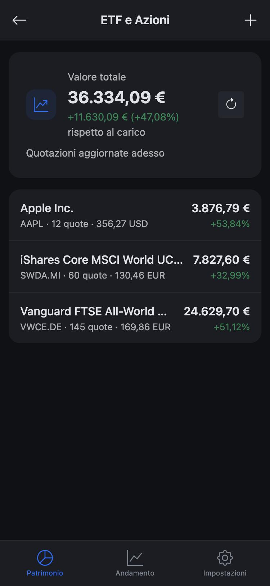

<div align="center">


# Tracktage

**Il tuo patrimonio, tutto in un posto.**
ETF, azioni, crypto, conti, fondo emergenza, auto, immobili e debiti in un'unica web app, con le quotazioni aggiornate in automatico.


</div>

<p align="center">
  
  
  
  
</p>

---

## Perché

I fogli di calcolo per il patrimonio diventano ingestibili: prezzi da aggiornare a mano, formule che si
rompono, nessuno storico. Tracktage è una web app **self-hosted e personale** che si installa sul telefono
come un'app. I prezzi degli ETF si aggiornano da soli e ogni giorno salva una fotografia del tuo
patrimonio netto, così vedi davvero come cresce nel tempo.

Niente cloud di terzi, niente abbonamenti, nessun dato condiviso: un file PHP e un file SQLite, sul tuo server.

## Funzionalità

- 📈 **Quotazioni live** di ETF, azioni e crypto da Yahoo Finance, senza API key, con cache e conversione automatica in euro
- 🔎 **Ricerca strumenti** per ticker, nome o ISIN (`IE00BK5BQT80` → `VWCE.DE`)
- 💰 **Guadagno/perdita** sul prezzo medio di carico, per voce e per sezione
- 🗂️ **Sezioni personalizzabili**, ognuna con valore *di mercato* (ticker × quote) o *manuale* (auto, conti, immobili…), icona e colore
- ➖ **Passività**: mutui e finanziamenti si sottraggono dal patrimonio netto
- 📊 **Storico** del patrimonio netto e dell'andamento di ogni sezione (1M, 3M, 1A, 5A, tutto)
- ⏰ **Promemoria** per i valori manuali fermi da troppo tempo (default 6 mesi)
- 🌙 **Tema chiaro, scuro o automatico**
- 💾 **Backup in un tap**: CSV delle voci, CSV dello storico (pronti per Excel) o il database completo
- 📱 **PWA mobile-first**, installabile sulla schermata Home di iOS e Android
- 🔒 **Accesso riservato a un solo utente**, senza registrazione pubblica (vedi [Sicurezza](#-sicurezza))

## Stack

| | |
|---|---|
| **Backend** | PHP 8.1+ vanilla, nessun framework, nessun Composer |
| **Database** | SQLite (WAL), creato e migrato in automatico al primo avvio |
| **Frontend** | jQuery 3.7, Bootstrap 5.3, Bootstrap Icons, Chart.js 4 |
| **Prezzi** | Yahoo Finance (chart + search API), con cache su DB |

Le librerie frontend sono incluse in `vendors/`. Chart.js viene caricato da jsDelivr con una versione fissa.

## Avvio rapido

**Requisiti:** PHP 8.1+ con le estensioni `pdo_sqlite` e `curl`.

```bash
git clone https://github.com/<tuo-utente>/tracktage.git
cd tracktage
cp .env.example .env
```

Per lo sviluppo locale imposta nel `.env`:

```env
BASE_URL=http://localhost:8000/
SESSION_SECURE=false
APP_DEBUG=true
```

Crea il tuo utente (la password viene chiesta in modo nascosto):

```bash
php bin/create-user.php tu@esempio.it "Nome" "Cognome"
```

Avvia il server:

```bash
php -S localhost:8000 index.php
```

Apri <http://localhost:8000>: al primo accesso trovi già le sezioni di default, pronte da riempire.

> Lo stesso comando `create-user.php` serve anche per **reimpostare la password** di un utente esistente.

## Configurazione

Tutto si configura nel file `.env`:

| Variabile | Default | Descrizione |
|---|---|---|
| `BASE_URL` | `http://localhost:8000/` | URL pubblico dell'app, **con lo slash finale** |
| `SESSION_NAME` | `tracktage_session` | Nome del cookie di sessione |
| `DB_PATH` | `database/tracktage.sqlite` | Percorso del database, relativo alla root o assoluto |
| `BASE_CURRENCY` | `EUR` | Valuta in cui viene espresso tutto il patrimonio |
| `PRICE_CACHE_MINUTES` | `15` | Durata della cache delle quotazioni |
| `STALE_MONTHS` | `6` | Mesi dopo i quali un valore manuale viene segnalato |
| `SESSION_SECURE` | `true` | Cookie solo su HTTPS. Mettilo a `false` solo in locale |
| `APP_DEBUG` | `false` | Mostra i dettagli degli errori. Mai `true` in produzione |

Le variabili d'ambiente già impostate hanno la precedenza sul `.env`, utile per test o container:

```bash
DB_PATH=/tmp/demo.sqlite php -S localhost:8001 index.php
```

## Ticker supportati

Si usa il formato Yahoo Finance, con il suffisso della borsa. Nel form puoi anche cercare per nome o ISIN.

| Mercato | Esempio |
|---|---|
| Borsa Italiana | `SWDA.MI`, `CSSPX.MI` |
| Xetra | `VWCE.DE`, `EUNL.DE` |
| Euronext Amsterdam | `IWDA.AS` |
| London Stock Exchange | `VWRA.L` (le quotazioni in pence vengono convertite) |
| USA | `AAPL`, `MSFT`, `VOO` |
| Crypto | `BTC-EUR`, `ETH-EUR` |

I prezzi in valute diverse da `BASE_CURRENCY` vengono convertiti con il tasso di cambio corrente.

## Deploy in produzione

1. Carica il progetto sul server, **senza** `.env` e `database/` locali (sono già nel `.gitignore`).
2. Crea il `.env` con `SESSION_SECURE=true`, `APP_DEBUG=false` e il tuo `BASE_URL` in HTTPS.
3. Rendi scrivibili dal web server la cartella `database/` (non solo il file: SQLite ci crea i file WAL) e `api/`, dove viene creata la cartella dei log.
4. Crea l'utente con `php bin/create-user.php`.
5. **Verifica** che `https://tuodominio/.env` e `https://tuodominio/database/tracktage.sqlite` rispondano **403**.

> 💡 Ancora meglio: sposta il database **fuori dalla document root** con `DB_PATH=/home/utente/data/tracktage.sqlite`.

### Apache

Funziona con il `.htaccess` incluso: servono `mod_rewrite` e `AllowOverride All`.

### Nginx

Nginx ignora i `.htaccess`, quindi le regole vanno nella configurazione del server:

```nginx
server {
    root /var/www/tracktage;
    index index.php;

    # Cartelle e file che non devono mai essere serviti
    location ~ ^/(database|bin|config|middleware|components|views|docs|api/(utils|services|log))/ { deny all; }
    location ~ /\.(?!well-known) { deny all; }
    location ~ \.(sqlite|sqlite3|sql|md)$ { deny all; }

    location / {
        try_files $uri $uri/ /index.php?$query_string;
    }

    location ~ \.php$ {
        include fastcgi_params;
        fastcgi_param SCRIPT_FILENAME $document_root$fastcgi_script_name;
        fastcgi_pass unix:/run/php/php8.3-fpm.sock;
    }
}
```

### Spostare i dati dal locale al server

Il file SQLite contiene tutto. Crea una copia consistente e caricala come `database/tracktage.sqlite`:

```bash
sqlite3 database/tracktage.sqlite ".backup database/upload.sqlite"
```

In alternativa scarica il database da **Impostazioni → Backup**.

## 🔒 Sicurezza

Tracktage è pensato per **un solo utente** e contiene dati sensibili, quindi:

- **Nessuna registrazione dal web**: gli utenti si creano solo da riga di comando sul server
- Password con **bcrypt**, aggiornate automaticamente se l'algoritmo cambia
- **Rate limiting** sul login: 5 tentativi falliti per IP in 15 minuti
- **Token CSRF** su ogni richiesta che modifica dati
- Cookie di sessione `HttpOnly`, `SameSite=Strict`, `Secure` in HTTPS, con ID rigenerato al login
- Header `X-Frame-Options`, `X-Content-Type-Options` e `Referrer-Policy`
- Database, configurazione, script e log bloccati dal web server
- Export CSV protetti dalla *formula injection* di Excel

## Backup

Da **Impostazioni → Backup**:

| Export | Contenuto |
|---|---|
| **Voci del patrimonio** (CSV) | Una riga per voce: sezione, ticker, quote, prezzi, valore, guadagno, note |
| **Storico** (CSV) | Una riga per giorno salvato, con il totale di ogni sezione |
| **Database completo** (`.sqlite`) | Copia consistente di tutto: per ripristinare, rimettila in `database/` |

I CSV usano `;` come separatore e la virgola decimale, quindi si aprono subito in Excel in italiano.

## Struttura del progetto

```
├── api/
│   ├── endpoint/      # Un file per azione: auth, assets, categories, market, portfolio, backup
│   ├── services/      # PriceService (quotazioni e cambi) · Portfolio (valorizzazione e snapshot)
│   └── utils/         # Connessione SQLite, auth/CSRF, risposte JSON, CSV, logger
├── bin/               # create-user.php (CLI)
├── components/        # Head, barra superiore e inferiore
├── config/            # Caricamento .env e configurazione
├── database/          # schema.sql (+ il file .sqlite, ignorato da git)
├── script/            # JavaScript per pagina + app.js (helper comuni)
├── style/             # CSS con variabili per tema chiaro e scuro
├── views/             # login · dashboard · category · statistics · settings
└── index.php          # Router (anche per il server di sviluppo PHP)
```

**Flusso:** `index.php` → `views/*.php` → AJAX → `api/endpoint/*` → `api/services/*` → SQLite

## Note

- Le quotazioni arrivano dalle API pubbliche **non ufficiali** di Yahoo Finance, che possono cambiare o limitare le richieste. Se un prezzo non è disponibile, l'app usa l'ultimo salvato e lo segnala.
- Lo storico si costruisce con l'uso: viene salvato uno snapshot al giorno quando apri la dashboard.
- Tracktage è uno strumento di monitoraggio personale e **non fornisce consulenza finanziaria**.

## Roadmap

- [ ] Movimenti di acquisto e vendita, con prezzo medio calcolato e storico ricostruito
- [ ] Snapshot giornalieri tramite cron
- [ ] Obiettivi: target del fondo emergenza e allocazione ideale con suggerimenti di ribilanciamento
- [ ] Autenticazione a due fattori (TOTP)
- [ ] Modalità privacy per nascondere gli importi
- [ ] Deprezzamento automatico dei veicoli
